  

  

  
  
  
  

---

## 👨‍💻 About Me

Multidisciplinary engineer working at the intersection of **railway simulation, real-time communications, full-stack development, and wireless sensing & ML**.

- 🚆 **Simulation & Training Engineer** (freelance) at **D&T S.r.l. – SHRail Division**, building simulation and digital tooling for the railway sector
- 🎓 M.Sc. candidate in **Internet and Multimedia Engineering** at the **University of Genoa** (DITEN), currently in the thesis phase
- 📡 Thesis on **Integrated Sensing and Communication (ISAC)**: teaching the base station *when* to sense, by adding a sensing-activation layer and incremental relearning to a Bayesian blockage-detection framework (GDBN / MJPF)
- ⚙️ Background in **electrical & electronic engineering, networking, and backend / full-stack development**
- 🔭 Interested in **wireless communications, RF fingerprinting, cognitive dynamic systems, FOSS, privacy tooling, and self-hosting**

## 💼 Experience & Education

| | Organization | Details |
| --- | --- | --- |
| 🚆 **Current role** | **D&T S.r.l. – SHRail Division** | Simulation & Training Engineer (freelance) · railway training simulators & digital tooling |
| 🎓 **M.Sc.** | **University of Genoa** | Internet and Multimedia Engineering · 2023 – present · thesis defense expected 2027 |
| 🎓 **B.Sc.** | **Babol Noshirvani University of Technology** | Electrical and Electronic Engineering |

## 🛠️ Tech & Tools

<table>
  <tr>
    <td align="center" width="140"><b>Languages</b></td>
    <td></td>
  </tr>
  <tr>
    <td align="center"><b>Backend</b></td>
    <td></td>
  </tr>
  <tr>
    <td align="center"><b>Frontend</b></td>
    <td></td>
  </tr>
  <tr>
    <td align="center"><b>Real-time</b></td>
    <td>
      
      
    </td>
  </tr>
  <tr>
    <td align="center"><b>Data & ML</b></td>
    <td></td>
  </tr>
  <tr>
    <td align="center"><b>DevOps & HW</b></td>
    <td></td>
  </tr>
</table>

<b>🔬 Specialized areas</b>

 

- Integrated sensing & communication, Bayesian dynamic models (GDBN, MJPF)
- Digital communications theory: fading channels, pulse shaping, baseband transmission, channel capacity
- WebRTC signaling (SDP / ICE), audio routing on embedded Linux (Raspberry Pi, PipeWire / PulseAudio)
- Queueing theory, Markov chains, and network modeling
- IPsec, TLS, IDS, and network security architectures
- Embedded systems and circuit design
- Machine learning, including PCA, Bayesian classification, clustering, and K-means

<b>🌍 Languages & certifications</b>

 

- **Persian:** Native or bilingual proficiency
- **English:** Full professional proficiency (IELTS 7.0 · C1)
- **Italian:** Elementary proficiency (A2)

**Certifications:** `Python 3` `JavaScript` `HTML` `CSS` `jQuery`

## 🚀 Featured Projects

<table>
  <tr>
    <td width="50%" valign="top">
      <h3>🚆 WebRTC Cab Radio Simulator</h3>
      <i>D&T – SHRail · proprietary</i>
      
Browser-based cab radio simulator for railway driver training: console-initiated WebRTC calls, reliable reconnect and remote reload, and audio routing on Raspberry Pi / Chromium terminals.

      <code>WebRTC</code> <code>Socket.io</code> <code>AngularJS</code> <code>Node.js</code> <code>Raspberry Pi</code>
    </td>
    <td width="50%" valign="top">
      <h3>🅿️ <a href="https://spaziovicino.it">Spazio Vicino</a></h3>
      <i>Live platform</i>
      
A parking and storage listing platform that connects people who have unused space with neighbours who need it.

      <code>React</code> <code>Vite</code> <code>Node.js</code> <code>Express</code> <code>MongoDB</code> <code>Nginx</code>
    </td>
  </tr>
  <tr>
    <td width="50%" valign="top">
      <h3>⚡ <a href="https://github.com/eliassrm/REST-API">FastAPI Workflow Manager</a></h3>
      
A modular REST API for managing workflows, commands, and role-based access.

      <code>FastAPI</code> <code>SQLModel</code> <code>PostgreSQL</code> <code>Docker</code>
    </td>
    <td width="50%" valign="top">
      <h3>🏠 <a href="https://github.com/eliassrm/AL-Smarthome-S">AL-Smarthome Generalization</a></h3>
      
A reusable, generalized refactoring of <code>al.py</code> for smart-home datasets.

      <code>Python</code> <code>Pandas</code> <code>OOP</code>
    </td>
  </tr>
  <tr>
    <td width="50%" valign="top">
      <h3>🚦 <a href="https://github.com/eliassrm/Traffic-Managment-Sys">Traffic Management System</a></h3>
      
A Django backend for traffic-management workflows.

      <code>Python</code> <code>Django</code>
    </td>
    <td width="50%" valign="top">
      <h3>📚 <a href="Tracker">Learning Tracker</a></h3>
      
Personal cheatsheets and notes on Python, NumPy, scikit-learn, clean code, and Markdown.

      <code>Python</code> <code>Markdown</code>
    </td>
  </tr>
</table>

## 📡 Research in Motion

  

## 📫 Let's Connect

I'm always happy to discuss research, engineering, and new collaboration opportunities.

  
  
  

  

<!-- 
## 📊 GitHub Stats

  

 -->
