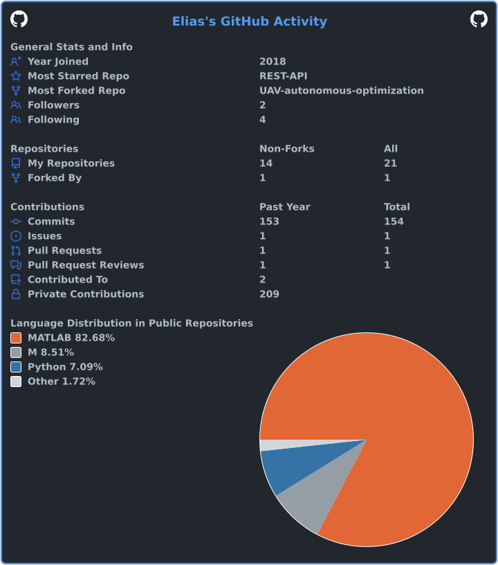

# Hi, I'm Elias 👋

### Software Engineering Consultant · Electrical & Network Engineer

Multidisciplinary engineer building reliable software and intelligent systems at the intersection of 
**software engineering, networking, machine learning, and optical communications**.

---

## 👨‍💻 About Me

- 📍 Based in **Genoa, Italy**
- 💼 Software Engineering Consultant at **D&T**
- 🎓 M.Sc. in **Internet and Multimedia Engineering** from the **University of Genoa**
- ⚙️ Background in **electrical engineering, network engineering, and backend development**
- 🔭 Interested in **UAVs, cognitive systems, AI-powered optical communications, and software development**
- 🤝 Open to **research collaborations and professional networking**

## 💼 Experience & Education

| | Organization | Details |
| --- | --- | --- |
| **Current role** | **D&T** | Software Engineering Consultant |
| **M.Sc.** | **University of Genoa** | Internet and Multimedia Engineering · 2023–2025 |

## 🛠️ Tech & Tools

| Area | Technologies |
| --- | --- |
| **Languages** | Python, C++, MATLAB |
| **Frameworks & Libraries** | FastAPI, Django, scikit-learn, Pandas, SQLModel |
| **Databases** | Microsoft SQL Server, PostgreSQL |
| **DevOps & Tools** | Linux, Git, Docker |

### Specialized Areas

- Queueing theory, Markov chains, and network modeling
- IPsec, TLS, IDS, and network security architectures
- Embedded systems and circuit design
- Machine learning, including PCA, Bayesian classification, clustering, and K-means

### Languages

- **Persian:** Native or bilingual proficiency
- **English:** Full professional proficiency
- **Italian:** Elementary proficiency

### Certifications

`Python 3` `JavaScript` `HTML` `CSS` `jQuery`

---

## 🚀 Featured Projects

### [FastAPI Workflow Manager](https://github.com/eliassrm/REST-API)

A modular REST API for managing workflows, commands, and role-based access.

`FastAPI` `SQLModel` `PostgreSQL` `Docker`

### [AL-Smarthome Generalization Project](https://github.com/eliassrm/AL-Smarthome-S)

A reusable, generalized refactoring of `al.py` for smart-home datasets.

`Python` `Pandas` `Object-Oriented Design`

### [Traffic Management System](https://github.com/eliassrm/Traffic-Managment-Sys)

A Django backend for traffic-management workflows.

`Python` `Django`

[//]: # (---)

[//]: # (## 💼 Experience)

[//]: # (**Graduate Researcher — University of Genoa**  )

[//]: # (_2024 – Present_  )

[//]: # (- Designed and modeled satellite communication systems with CTMC fading and queueing analysis.  )

[//]: # (- Developed FastAPI-based backend systems for modular workflow execution and access control.  )

[//]: # (- Conducted performance analysis of GaN-based LEDs and photonic devices.  )

[//]: # (- Applied ML algorithms for network behavior prediction and system optimization.)

[//]: # ()
[//]: # (**Electronics Engineer — Industry & Research Projects**  )

[//]: # (_2020 – 2023_  )

[//]: # (- Developed embedded control systems and data acquisition software.  )

[//]: # (- Worked on antenna modeling, signal propagation, and system reliability analysis.  )

[//]: # (- Created simulation frameworks for optical and electronic components.  )

---

[//]: # (## 🎓 Education)

[//]: # ()
[//]: # (**M.Sc. Internet and Multimedia Engineering** — University of Genoa, Italy  )

[//]: # (Focus: Cognitive Dynamic Systems, Machine Learning, UAV Communication Systems  )

[//]: # ()
[//]: # (**B.Sc. Electrical and Electronic Engineering** — Babol Noshirvani Institute of Technology, Iran  )

[//]: # (Focus: Circuit Design, Telecommunications, Electronics, GaN/InGaN LEDs)

[//]: # ()
[//]: # ([//]: # &#40;---&#41;)
[//]: # ()
[//]: # ([//]: # &#40;## 🌍 Open Source & Community&#41;)
[//]: # ()
[//]: # ([//]: # &#40;- Active contributor to open FastAPI and simulation repositories.  &#41;)
[//]: # ()
[//]: # ([//]: # &#40;- Passionate about documenting research-grade projects for public use.  &#41;)
[//]: # ()
[//]: # ([//]: # &#40;- Advocate for reproducible scientific computing and education in network engineering.&#41;)
[//]: # ()
[//]: # (---)

## 📫 Let's Connect

I'm always happy to discuss research, engineering, and new collaboration opportunities.

- **Email:** [EliasSaffarmoghadam@gmail.com](mailto:EliasSaffarmoghadam@gmail.com)
- **LinkedIn:** [linkedin.com/in/elias-saffarmoghadam](https://www.linkedin.com/in/elias-saffarmoghadam/)
- **GitHub:** [github.com/eliassrm](https://github.com/eliassrm)

---
<!-- 
## 📊 GitHub Stats

  

 -->
